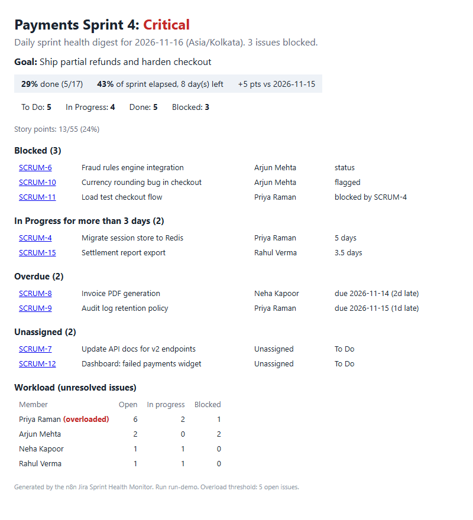
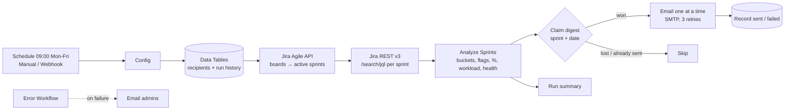

# Jira Sprint Health Monitor & Daily Digest (n8n)

An n8n workflow that watches every active Jira sprint and emails the team a daily health digest: progress, blockers, stale work, overdue and unassigned issues, and who is overloaded. Built for the Epsilon automation assignment.

**Authors:** Sanjna J · Manikonda Chethan Krishna

## Problem

The team only learns about sprint health in stand-ups or by opening the board. Blocked issues, tickets stuck "In Progress" for days, missed due dates and uneven workloads aren't visible until someone looks for them, often too late to recover the sprint.

## Solution

Every weekday at 09:00 (Asia/Kolkata), n8n runs the steps below. The brief says "daily"; we picked Mon–Fri because sprints don't move at weekends. Running every day is a one-field change in the Schedule trigger (`0 9 * * *`).


1. Fetches every sprint-capable board (company-managed `scrum` and team-managed `simple`) and its **active sprints** from the Jira Agile REST API (paged with `startAt`/`isLast`).
2. Fetches **all issues** in each sprint through Jira REST v3 `/search/jql` (paged with `nextPageToken`).
3. Groups issues into **To Do / In Progress / Done / Blocked**.
4. Flags issues that are **In Progress for more than 3 days**, **overdue**, **unassigned** or **Blocked**.
5. Calculates **sprint completion %**, compares it with the share of the sprint that has elapsed, and adds the change since yesterday's digest.
6. Finds **team members with a high number of unresolved issues**.
7. Builds a **daily sprint health summary** rated Healthy, At Risk, Critical or Empty.
8. **Emails** it to the recipients listed in a Data Table, exactly once per sprint per day, even when runs overlap.



## Architecture



Full design: [docs/architecture.md](docs/architecture.md)

## Business rules

| Rule | Definition | Config key |
|---|---|---|
| Blocked | Status name in `blockedStatusNames`, **or** the Jira *Flagged* field is set, **or** an unresolved "is blocked by" link exists. Done issues are never blocked. | `blockedStatusNames`, `flaggedField` |
| In Progress > 3 days | Status category *In Progress* and `statuscategorychangedate` older than N days. Uses the time the issue entered the category, not `updated` (comments don't reset it). | `staleInProgressDays` = 3 |
| Overdue | `duedate` before **today in the team's timezone**, and not Done | `timezone` |
| Unassigned | No assignee and not Done | |
| Overloaded member | ≥ N unresolved issues in the sprint | `overloadThreshold` = 5 |
| Completion % | Done ÷ total issues (story points shown too when the field exists) | `storyPointsField` |
| Health | **Critical**: ≥3 blocked or ≥30 pts behind elapsed time · **At Risk**: any blocked, overdue, overloaded member, or ≥15 pts behind · **Healthy**: otherwise · **Empty**: no issues | `critical*`, `atRiskBehindPct` |

## What changed since our ServiceNow project (reviewer feedback)

| Feedback | What we did here |
|---|---|
| Use a database instead of n8n static data for state | Two **n8n Data Tables** (created automatically), queryable in the UI: `sprint_digest_recipients` and `sprint_health_runs`. The second holds the claim history and the daily snapshots used for trends. Data Tables can't make our own columns unique (only table and column names are), so dedupe uses a claim/read-back protocol. |
| Test concurrent executions and failure scenarios | 21 automated end-to-end scenarios, including **5 overlapping runs** (one email per sprint), Jira 500/429/outage, SMTP rejection, crash recovery |
| Pagination beyond the 200-record limit | n8n's built-in HTTP pagination on all three Jira calls (`startAt`/`isLast`, `nextPageToken`), with a page cap |
| Don't hard-code email addresses (feedback to the other team) | Recipients and admins live in a Data Table; per-board routing; `active` flag |
| Date/time-zone handling (feedback to the other team) | "Today", overdue checks and the digest key all use the configured timezone; Jira `+0530` offsets parsed explicitly |

## Repository

```
├── README.md
├── plan.md                          # task split and status
├── workflows/
│   ├── jira-sprint-health-monitor.json   # main workflow (credential-free export)
│   ├── error-handler.json                # error workflow → emails admins
│   └── README.md                         # import + configuration guide
├── src/                             # Code-node logic (unit-tested, inlined at build time)
│   ├── analyze.js  claims.js  config.js
├── scripts/
│   ├── build-workflows.js           # src/ → workflows/*.json
│   ├── seed-jira.js                 # creates the sample sprint in a real Jira site
│   └── write-test-report.js
├── tests/
│   ├── unit.test.js  run-e2e.js  fixtures.js
│   ├── mock-jira.js  smtp-sink.js  setup-test-env.sh
├── docs/
│   ├── architecture.md  test-results.md  sample-digest.html  img/
└── deck/
    ├── Jira-Sprint-Health-Monitor.pptx                 # detailed deck with test results (27 slides)
    ├── Jira-Sprint-Health-Monitor-Proposed-Plan.pptx   # proposed-plan deck (21 slides, speaker notes included)
    ├── Proposed-Plan-Speaker-Notes.md                  # slide-by-slide talking points for the plan deck
    ├── plan-notes.js                                   # source of those notes
    └── build-deck.js                                   # npm run deck (detailed) / node deck/build-deck.js --plan
```

## Quick start

See [workflows/README.md](workflows/README.md). In short: create a Jira Cloud Scrum project, run `scripts/seed-jira.js`, create three n8n credentials (Jira, SMTP, webhook token), import both workflows, add recipients to the Data Table, try a dry run, then publish.

## Testing

```bash
npm test                    # unit tests
npm run e2e:setup           # isolated n8n + mock Jira + SMTP sink
npm run e2e                 # 21 scenarios → docs/test-results.e2e.json
```

Current results: **21/21 end-to-end, 16/16 unit**, all against the mock Jira and SMTP sink ([docs/test-results.md](docs/test-results.md)). The live-site checklist is at the end of that file.

## Security

- No tokens, passwords or real addresses are in the repo. Workflow exports reference credentials by name only.
- The Jira API token goes in n8n's encrypted credential store, and the on-demand webhook requires a header token.
- Use a Jira account with browse-only access to the monitored projects.
- `.n8n-test/` (local test instance with fake credentials) and `temp/` are git-ignored.
